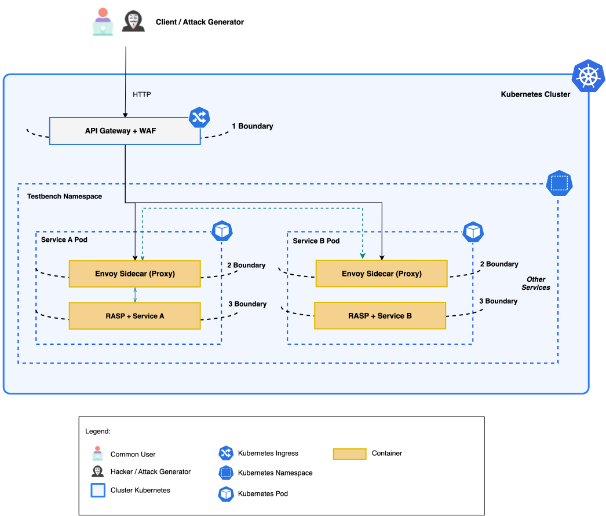

# MLCNP Blueprint

[Português](README.md) · [kubectl guide](deploy/kubectl) · [Security](SECURITY.md) · [Paper](#related-paper)

A reproducible multi-layer protection blueprint for applications running on Kubernetes.

**MLCNP (Multi-Layered Cloud-Native Protection)** follows a request from the cluster entry point to application execution. Three boundaries combine perimeter visibility, service-local controls, and protection inside the runtime.



## One request, three boundaries

1. **Perimeter:** ModSecurity and OWASP Core Rule Set inspect the request at the gateway.
2. **Communication:** an nginx sidecar proxy applies local controls before forwarding traffic.
3. **Execution:** OpenRASP follows the request inside the application JVM.

```text
Client
  → gateway with ModSecurity and OWASP CRS
  → workload Service
  → nginx sidecar proxy
  → Java application with OpenRASP
```

The template also includes `NetworkPolicies` that authorize traffic between the gateway and workload.

## Get started

Install Docker, Minikube, and `kubectl`. Clone the repository and run:

```bash
git clone https://github.com/vinimrs/mlcnp-blueprint.git
cd mlcnp-blueprint
make quickstart
```

This starts Minikube, builds the reference application, loads the image, and installs all resources in the `mlcnp-blueprint` namespace.

Open the gateway:

```bash
make forward
```

In another terminal, send a request:

```bash
curl --include http://127.0.0.1:18080/application/
```

The response identifies the three boundaries:

```text
HTTP/1.1 200 OK
X-MLCNP-Gateway: modsecurity-crs
X-MLCNP-Sidecar: nginx
X-MLCNP-Sidecar-Policy: baseline-v1
X-Protected-By: OpenRASP
```

The [kubectl guide](deploy/kubectl/README.md) lists each command and explains how to inspect the installed objects.

## Bring your application

The template uses a simple port contract:

| Component | Port |
|---|---:|
| Gateway | `8080` |
| Sidecar proxy | `8081` |
| Application | `8080` |

To use another image, change only the `images` block in [`kustomization.yaml`](deploy/kubectl/kustomization.yaml):

```yaml
images:
  - name: mlcnp/java-openrasp-demo
    newName: ghcr.io/your-organization/your-application
    newTag: 1.0.0
```

The new image should run an HTTP application on port `8080` and load a compatible RASP agent. The [reference Dockerfile](images/java-openrasp-demo/Dockerfile) shows how to install a Java Agent in Tomcat.

Customize the route in [`gateway.yaml`](deploy/kubectl/gateway.yaml) and allowed flows in [`network-policies.yaml`](deploy/kubectl/network-policies.yaml) when your application topology requires it.

## Validation

Validate the manifests locally:

```bash
make validate
```

With the blueprint installed, run the complete test:

```bash
make verify
```

The test crosses the gateway, sidecar, application, and OpenRASP. It also checks WAF blocking, network isolation, and the method and request-size limits enforced by the sidecar.

## Removal

```bash
make uninstall
make stop
```

## Main structure

```text
deploy/kubectl/             Kubernetes resources
images/java-openrasp-demo/  Java application with OpenRASP
docs/assets/                architecture diagram
scripts/                    static and integration validation
```

## Production evolution

OpenRASP 1.3.7 is the reference implementation and uses `linux/amd64` components. For production, select a maintained RASP solution and integrate your organization's identity, TLS, secrets, admission, supply-chain, and observability controls.

See the [security policy](SECURITY.md) for additional guidance.

## Related paper

The architecture is presented in:

> Vinícius Matheus Romualdo Santos and Lina Garcés. **“A Multi-Layered Architecture for Microservices with Self-Protection Properties.”** AISecDev 2026, São Paulo, SP, Brazil, September 2026.

Use [CITATION.cff](CITATION.cff) to import the project reference into citation managers.

## Contributing and license

Contributions are welcome. Read [CONTRIBUTING.md](CONTRIBUTING.md) and run `make validate` before opening a pull request.

Original repository content is licensed under [Apache-2.0](LICENSE). Third-party components retain their respective licenses and trademarks; see [NOTICE](NOTICE).
