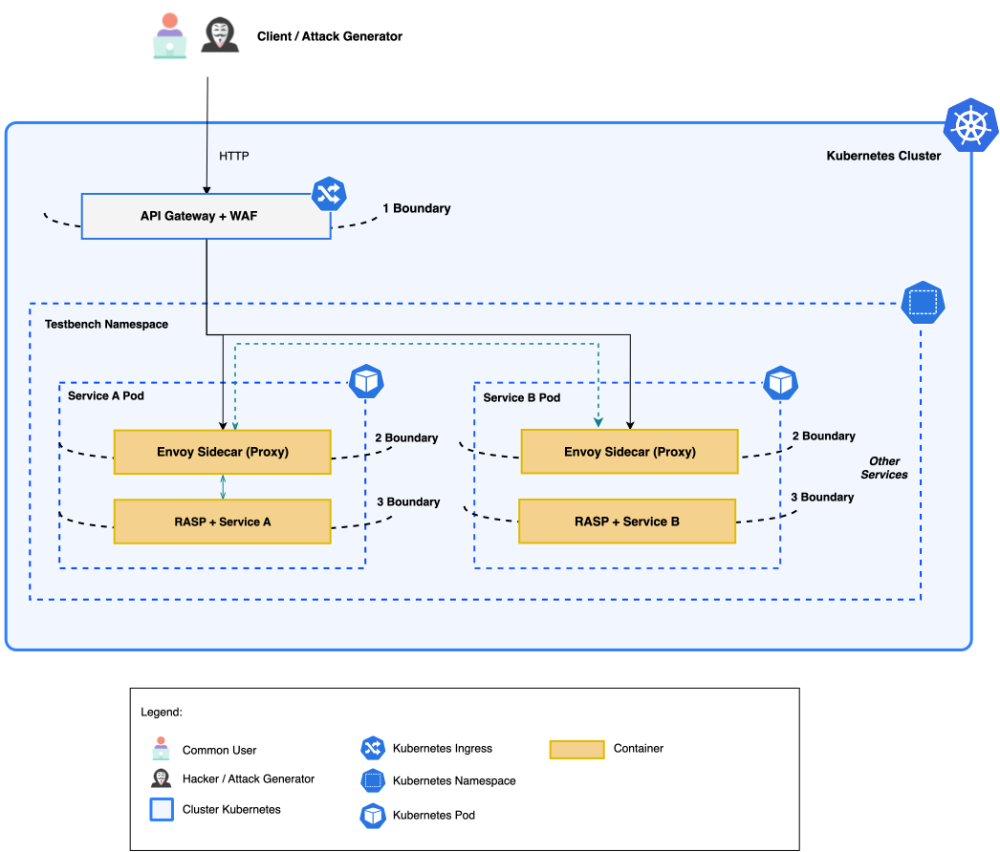

# MLCNP Blueprint

[English](README.en.md) · [Guia kubectl](deploy/kubectl) · [Segurança](SECURITY.md) · [Artigo](#artigo-relacionado)

Um blueprint reproduzível de proteção em múltiplas camadas para aplicações executadas no Kubernetes.

A **MLCNP (Multi-Layered Cloud-Native Protection)** acompanha uma requisição desde a entrada no cluster até a execução da aplicação. Três fronteiras combinam visibilidade de perímetro, controles próximos ao serviço e proteção dentro do runtime.



## Uma requisição, três fronteiras

1. **Perímetro:** ModSecurity e OWASP Core Rule Set inspecionam a requisição no gateway.
2. **Comunicação:** um proxy nginx sidecar aplica controles locais antes de encaminhar o tráfego.
3. **Execução:** o OpenRASP acompanha a requisição dentro da JVM da aplicação.

```text
Cliente
  → gateway com ModSecurity e OWASP CRS
  → Service do workload
  → proxy sidecar nginx
  → aplicação Java com OpenRASP
```

O template também inclui `NetworkPolicies` que autorizam o fluxo entre gateway e workload.

## Comece agora

Tenha Docker, Minikube e `kubectl` instalados. Clone o repositório e execute:

```bash
git clone https://github.com/vinimrs/mlcnp-blueprint.git
cd mlcnp-blueprint
make quickstart
```

Esse comando inicia o Minikube, constrói a aplicação de referência, carrega a imagem e instala todos os recursos no namespace `mlcnp-blueprint`.

Abra o gateway:

```bash
make forward
```

Em outro terminal, envie uma requisição:

```bash
curl --include http://127.0.0.1:18080/application/
```

A resposta identifica as três fronteiras percorridas:

```text
HTTP/1.1 200 OK
X-MLCNP-Gateway: modsecurity-crs
X-MLCNP-Sidecar: nginx
X-MLCNP-Sidecar-Policy: baseline-v1
X-Protected-By: OpenRASP
```

O [guia kubectl](deploy/kubectl/README.md) apresenta os comandos individualmente e explica como inspecionar os objetos criados.

## Leve o blueprint para sua aplicação

O template adota um contrato simples de portas:

| Componente | Porta |
|---|---:|
| Gateway | `8080` |
| Proxy sidecar | `8081` |
| Aplicação | `8080` |

Para usar outra imagem, altere apenas o bloco `images` em [`kustomization.yaml`](deploy/kubectl/kustomization.yaml):

```yaml
images:
  - name: mlcnp/java-openrasp-demo
    newName: ghcr.io/sua-organizacao/sua-aplicacao
    newTag: 1.0.0
```

A nova imagem deve executar uma aplicação HTTP na porta `8080` e carregar um agente RASP compatível. O [Dockerfile de referência](images/java-openrasp-demo/Dockerfile) mostra a instalação de um Java Agent em Tomcat.

Personalize a rota no [`gateway.yaml`](deploy/kubectl/gateway.yaml) e os fluxos autorizados em [`network-policies.yaml`](deploy/kubectl/network-policies.yaml) quando a topologia da aplicação exigir.

## Validação

Valide os manifests localmente:

```bash
make validate
```

Com o blueprint instalado, execute o teste completo:

```bash
make verify
```

O teste percorre gateway, sidecar, aplicação e OpenRASP. Ele também confirma o bloqueio do WAF, o isolamento de rede e os limites de método e tamanho de requisição aplicados pelo sidecar.

## Remoção

```bash
make uninstall
make stop
```

## Estrutura principal

```text
deploy/kubectl/             recursos Kubernetes
images/java-openrasp-demo/  aplicação Java com OpenRASP
docs/assets/                diagrama da arquitetura
scripts/                    validações estática e de integração
```

## Evolução para produção

O OpenRASP 1.3.7 é a implementação de referência e utiliza componentes `linux/amd64`. Para produção, selecione uma solução RASP mantida e integre os controles de identidade, TLS, segredos, admissão, cadeia de suprimentos e observabilidade adotados pela sua organização.

Consulte a [política de segurança](SECURITY.md) para orientações adicionais.

## Artigo relacionado

A arquitetura é apresentada em:

> Vinícius Matheus Romualdo Santos e Lina Garcés. **“A Multi-Layered Architecture for Microservices with Self-Protection Properties.”** AISecDev 2026, São Paulo, SP, Brasil, setembro de 2026.

Use o arquivo [CITATION.cff](CITATION.cff) para importar a referência do projeto em gerenciadores de citações.

## Contribuição e licença

Contribuições são bem-vindas. Leia [CONTRIBUTING.md](CONTRIBUTING.md) e execute `make validate` antes de abrir uma pull request.

O conteúdo próprio deste repositório é distribuído sob a licença [Apache-2.0](LICENSE). Componentes de terceiros mantêm suas respectivas licenças e marcas; consulte [NOTICE](NOTICE).
